# 🏝️ Bumiayu TUI (Window Manager Edition)

> **Terminal Window Manager & Lightweight System Launcher Ultra-Ringan**  
> *Ditenagai Mesin Animasi Adaptif 24 FPS, Estetika 16-Bit / 8-Bit Retro, Autocomplete Cerdas, dan Ramah SSH.*  
> *Dirancang khusus untuk **ODROID-C2 (ARM64 Amlogic S905)** & **Linux Server (x86_64 / ARM64)**.*

[](LICENSE)
[](https://go.dev)
[](https://github.com/faisalfa123/bumiayu-de)
[](https://github.com/faisalfa123/bumiayu-de)
[](https://github.com/faisalfa123/bumiayu-de)
[](https://github.com/faisalfa123/bumiayu-de)

---

## 🎬 Tampilan & Demo Animasi

Berikut adalah demonstrasi visual antarmuka **Bumiayu TUI** dengan nuansa Window Manager, layout panel tersusun rapi, indikator equalizer 24 FPS, dan *Unified Spotlight Launcher* dengan fitur *ghost-text autocomplete*:

<div align="center">
  
</div>

```
╔════════════════════════════════════════════════════════════════════════════════════════╗
║ 👾 (•_•) BUMIAYU-DE [16-Bit Cyber]   ❄️ 42.1°C   RAM: 412/2048 MB (20%)   Load: 0.18    ║
║ 📡 TICKER: ⚡ BUMIAYU TUI WM  ✦  ADAPTIVE 24 FPS READY  ✦  PRESS [SPACE] FOR LAUNCHER   ║
╠══════════════════════════════════════╦═════════════════════════════════════════════════╣
║ 📊 [1] TELEMETRI HARDWARE   [LIVE]   ║ ⚙️ [2] LAYANAN SYSTEMD               [10 Unit] ║
║ CPU    [████░░░░░░░░░░░░]  25%       ║   ● RUN   ssh.service        4.8MB             ║
║ RAM    [███░░░░░░░░░░░░░]  20%       ║ ► ● RUN   nginx.service      6.2MB             ║
║ TEMP   [██████░░░░░░░░░░]  42%       ║   ○ STOP  docker.service     0.0MB             ║
║ EQ 24F:  ▂▃▄▅   💚 [PULSE OK]        ║ [S]: Start  |  [T]: Stop  |  [R]: Restart       ║
╠══════════════════════════════════════╬═════════════════════════════════════════════════╣
║ ⚡ [3] TASK MANAGER (OOM)   [7 Pros] ║ 🛡️ [4] JARINGAN & PORT              [🛡️ UFW ON] ║
║ 1205  dockerd      84.0MB  OOM:200!  ║   22   tcp  PUBLIK  sshd (OpenSSH Server)       ║
║ 1350  containerd   42.0MB  OOM:120   ║   80   tcp  PUBLIK  nginx (HTTP Web)            ║
║ [K]: Kill Process SIGTERM (Protected)║   443  tcp  LOKAL   nginx (HTTPS SSL)           ║
╠══════════════════════════════════════╩═════════════════════════════════════════════════╣
║ [Space] Launcher  [Tab/hjkl] Nav  [f] Zoom  [1-4] Panels  [T] Tema  [?] Help  [q] Quit ║
╚════════════════════════════════════════════════════════════════════════════════════════╝
```

---

## ✨ Fitur Unggulan

### 1. 🪟 Nuansa Terminal Window Manager (Hybrid Tiling)
* **Panel Tiling Terintegrasi**: 4 kuadran kerja utama (Telemetri Hardware, Layanan Systemd, Task Manager OOM, Jaringan & Firewall) tertata otomatis dan rapi.
* **Active Glow & Shimmer Border**: Panel yang sedang fokus memiliki bingkai neon menyala berdenyut.
* **Zoom / Fullscreen Toggle (`f`)**: Tekan tombol `f` untuk memperbesar jendela terpilih memenuhi seluruh layar terminal, dan tekan `f` atau `Esc` untuk kembali ke mode tiling.

### 2. 🔍 Unified Spotlight Launcher dengan Bantuan Ketik Cerdas
* **Akses Cepat Cukup Tekan `Space` atau `/`**: Pop-up modal melayang di tengah layar ala *Rofi / Spotlight*.
* **Ghost-Text Inline Autocomplete**: Saat mengetik `ngi`, sistem langsung menampilkan teks bayangan abu-abu `nx.service`. Cukup tekan **`Tab`** atau **`→`** untuk melengkapi kata!
* **Fuzzy Search & Typo-Tolerant Correction**: Salah ketik (misal: `ngnx` atau `clea`) tetap akan ditebak dan disarankan ke perintah atau layanan yang tepat.
* **Quick Actions / Macro**:
  * `>clean` — Flush memory cache & pagecache Linux kernel.
  * `>ports` — Audit instan seluruh port terbuka publik dan lokal.
  * `>ufw` — Nyalakan atau matikan proteksi firewall.
  * `>kill-oom` — Deteksi dan tembak proses paling boros RAM.
  * `>theme` — Beralih tema retro instan.

### 3. 🕹️ Mesin Animasi Adaptif 24 FPS (Adaptive Framerate)
* **24 FPS Mulus**: Saat navigasi keyboard, running marquee ticker, animasi equalizer audio retro, dan sprite maskot bergerak di 24 frame per detik (~41ms).
* **Auto Low-Power Throttling (2 FPS)**: Saat tidak ada interaksi selama 2.5 detik, sistem otomatis memperlambat ke mode standby hemat daya (1–2 FPS). Penggunaan CPU tetap **< 2%** di ODROID-C2 (ARM64) dan sangat hemat kuota SSH!

### 4. 🇮🇩 Running Panorama 3-Baris Nusantara & Bintang di Bawah Layar
Menghadirkan strip pemandangan bergerak bertingkat 3-baris (langit, siluet arsitektur budaya/alam, dan tanah/samudra) yang berjalan mulus 24 FPS di atas quickbar navigasi:
* **9 Tema Budaya Nusantara & Kosmik**:
  * **`>auto`**: Rotasi tema otomatis setiap 60 detik melintasi Nusantara.
  * **`>nusantara`**: Siluet megah Kapal Layar Pinisi membelah ombak samudra kepulauan.
  * **`>jawa`**: Stupa Candi Borobudur, Gunungan wayang kulit, & terasering sawah tanah Jawa.
  * **`>sumatra`**: Atap gonjong bertingkat Rumah Gadang Minangkabau & Danau Toba.
  * **`>bali`**: Gapura Candi Bentar, Meru Pura Ulun Danu Beratan, & janur penjor.
  * **`>kalimantan`**: Burung Enggang Gading kanopi rimba & Rumah Betang Sungai Mahakam.
  * **`>sulawesi`**: Atap perahu Rumah Adat Tongkonan Toraja & Pinisi di laut terumbu karang.
  * **`>papua`**: Rumah jerami bulat Honai, tarian Cendrawasih, & puncak salju Jayawijaya.
  * **`>bumiayu`**: Jembatan legendaris Sakalibel dengan lokomotif uap di kaki Gunung Slamet.
  * **`>bintang`**: Langit malam tenang bertabur rasi bintang kosmik & komet berekor.
  * **`>panorama off`**: Matikan panorama jika ingin layar lebih ringkas.

### 5. 🪟 Clean Solid Dashboard & Search Bar Backdrop
* **Dashboard 100% Bersih & Solid**: Area kerja dan tabel proses bebas dari partikel pengganggu, teks sangat tajam dan tidak ada glitch/duplikasi baris di PowerShell maupun SSH.
* **Backdrop Animasi Search Bar**: Animasi latar bergerak tampil sebagai backdrop saat Spotlight Search Bar (`Space`) dibuka.

### 6. 🔀 3 Model Tata Letak Jendela (Layout Switcher)
Ubah tata letak jendela kerja secara instan lewat Spotlight Launcher:
* **`>layout tiling`** — Grid seimbang 2x2 (4 kuadran kerja simetris).
* **`>layout master`** — Master-Stack (1 panel telemetri besar di kiri + 3 kartu di kanan).
* **`>layout split`** — Horizontal Split (Baris telemetri atas + Baris proses bawah).

### 7. 🧹 Auto Clean RAM & Cache Scheduler
Otomatis lepaskan beban RAM yang tertahan di kernel Linux (drop_caches & dentries):
* **`>autoclean 15m`** — Jadwalkan pembersihan RAM otomatis tiap 15 menit.
* **`>autoclean 30m`** — Jadwalkan pembersihan RAM otomatis tiap 30 menit.
* **`>autoclean 1h`** — Jadwalkan pembersihan RAM otomatis tiap 1 jam.
* **`>clean`** — Pembersihan RAM manual instan sekali tekan.
* **`>autoclean off`** — Matikan pembersihan otomatis.

### 8. 🎨 Palet Estetika Multi-Theme Retro
Ganti tema instan cukup dengan menekan tombol **`T`**:
* **16-Bit Cyber-Arcade (Default)**: Cyan neon `#00F5FF`, Magenta/Violet `#E024A5`, latar Deep Cyber Navy, dan aksen laser amber.
* **Classic DOS / Norton Commander**: Nuansa server legendaris 90-an dengan double-box border (`╔═╗`), latar biru pekat, font putih/kuning terang.
* **8-Bit GameBoy Green**: Palet monokrom 4-tingkat hijau klasik khas handheld retro.
* **Obsidian Dark & Clean Mac Light**: Tema modern minimalis untuk kebutuhan profesional.

### 9. 🛡️ Senior Safety Guard
Tindakan berisiko tinggi (menghentikan layanan `ssh.service` atau membunuh proses root kritis) secara otomatis dilindungi dialog konfirmasi bertanda bahaya retro untuk mencegah koneksi remote terputus secara tidak sengaja.

---

## 🎮 Panduan Pintasan Keyboard (Controls)

Panduan utama selalu terpampang di kaki layar (*Persistent Footer Quickbar*). Tekan **`?`** kapan saja untuk membuka layar bantuan visual arcade lengkap:

| Tombol | Tindakan |
|---|---|
| **`Space`** atau **`/`** | Buka **Unified Spotlight Launcher** (Pencarian & Perintah Cepat) |
| **`Tab`** / **`→`** | Terima tebakan kata (*Ghost-Text Autocomplete*) di dalam Launcher |
| **`Tab`** / **`Shift+Tab`** | Pindah fokus antar panel jendela Window Manager |
| **`h` / `j` / `k` / `l`** atau **Panah** | Navigasi arah (Vim-style navigation) |
| **`f`** | **Zoom / Fullscreen** panel yang sedang aktif |
| **`1` - `4`** | Langsung lompat ke Panel 1 s/d 4 |
| **`S`** / **`T`** / **`R`** | **Start** / **Stop** / **Restart** unit Systemd pada panel layanan |
| **`K`** | Hentikan paksa proses (*Kill Process SIGTERM*) dengan Safety Guard |
| **`U`** | Nyalakan / Matikan Dinding Api (*Toggle UFW Firewall*) |
| **`T`** | Ganti Tema Tampilan (**Cyber-Arcade** ⇄ **DOS Norton** ⇄ **GameBoy**) |
| **`B`** | Ganti Animasi Background (**Sawah** ⇄ **Slamet** ⇄ **Sakalibel** ⇄ **Off**) |
| **`L`** | Ganti Bahasa Antarmuka (**Bahasa Indonesia** ⇄ **English**) |
| **`?`** | Buka pop-up modal visual **HOW TO PLAY / CONTROLS** |
| **`Esc`** | Tutup pop-up modal / batalkan aksi / keluar dari mode Zoom |
| **`q`** atau **`Ctrl+C`** | Keluar dari Bumiayu TUI |

---

## 🚀 Panduan Instalasi Cepat (1-Baris)

### Di ODROID-C2 atau Server Linux (Ubuntu / Debian / DietPi / Armbian):

```bash
curl -fsSL https://raw.githubusercontent.com/faisalfa123/bumiayu-de/main/scripts/install.sh | sudo bash
```

> **Catatan Pembaruan (Auto-Update):**  
> Menjalankan perintah di atas pada sistem yang sudah terpasang Bumiayu TUI akan secara otomatis mendeteksi dan memperbaruinya ke versi terbaru.

---

## 🛠️ Kompilasi & Pengujian Mandiri

```bash
# Clone repository
git clone https://github.com/faisalfa123/bumiayu-de.git
cd bumiayu-de

# Jalankan pengujian unit
go test -v ./...

# Kompilasi binary
go build -o bin/bumiayu ./cmd/bumiayu

# Jalankan aplikasi
./bin/bumiayu
```

---

## 📄 Lisensi

Proyek ini dirilis di bawah lisensi terbuka [MIT License](LICENSE).
Bebas dimodifikasi, didistribusikan, dan digunakan untuk server rumahan, SBC ODROID, maupun server cloud enterprise.
